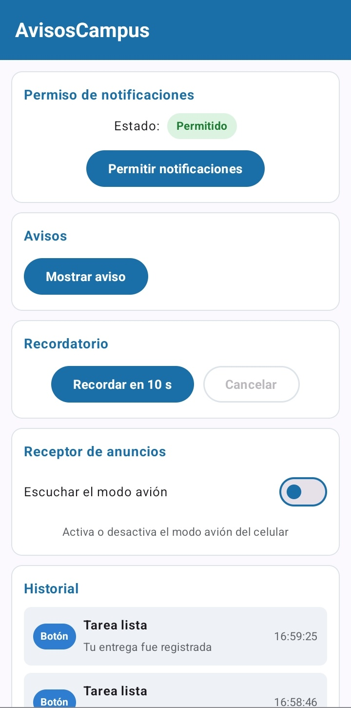
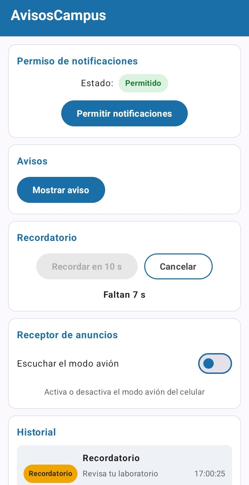
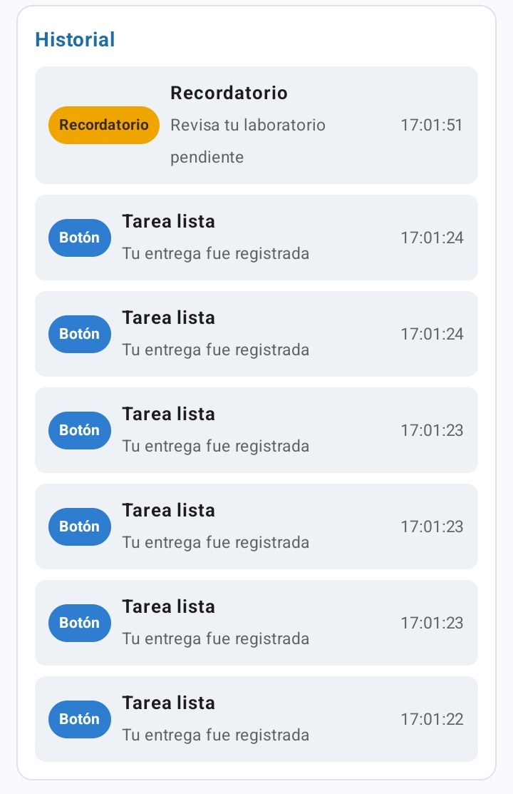
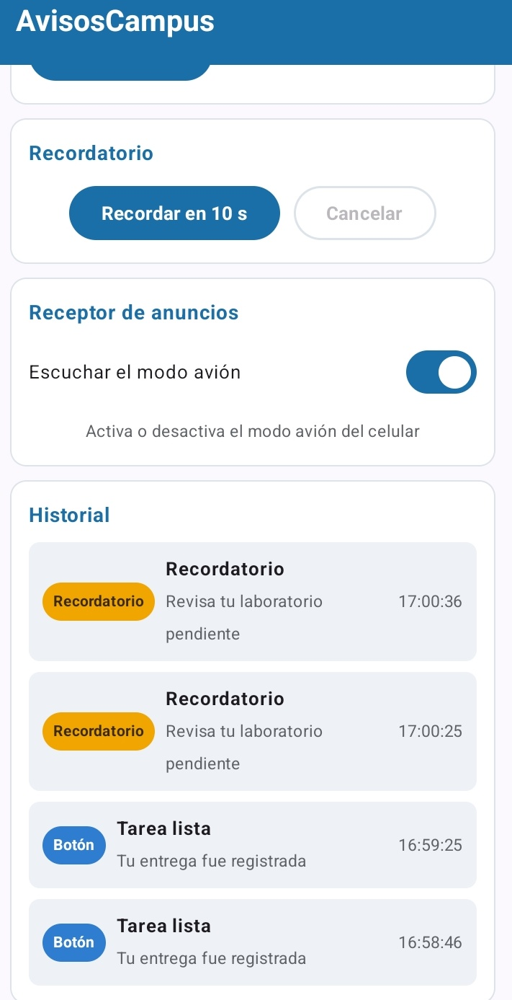
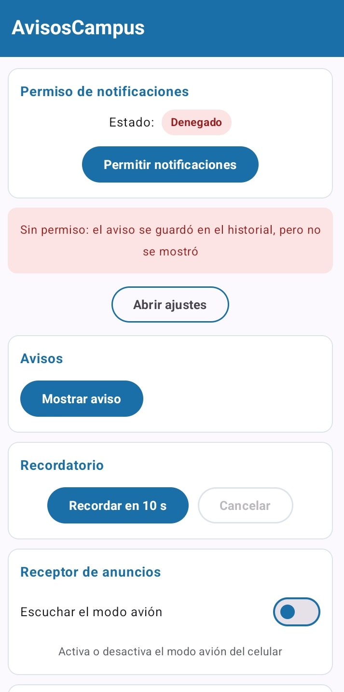

# AvisosCampus

**Autor:** José Rojas Condor
**Curso:** Programación en Móviles · 4to ciclo · TECSUP
**Docente:** Juan José León Suiyon
**Semana 15:** Notificaciones en Android

## Descripción

AvisosCampus es una app hecha con Kotlin, Jetpack Compose y Material 3 que muestra notificaciones locales y escucha lo que pasa en el celular. Con un botón muestra un aviso, con otro programa un recordatorio que llega a los 10 segundos (con cuenta regresiva y opción de cancelar) y, si se activa el switch, avisa cuando el usuario activa o desactiva el modo avión usando un `BroadcastReceiver`. Todos los avisos quedan anotados en un historial, y si el usuario niega el permiso la app no se cierra: guarda el aviso, muestra un mensaje y ofrece abrir los ajustes.

Usa el patrón **MVVM + Repository** y solo datos ficticios.

## Estructura de paquetes

```
com.rojas.avisoscampus/
├── AvisosApp.kt                 Application: crea el canal
├── MainActivity.kt
├── model/
│   └── Modelos.kt               Aviso, Origen, PermisoUi
├── data/
│   └── AvisosRepository.kt      interface + AvisosRepositoryMemoria
├── notificacion/
│   └── Notificador.kt           canal, permiso y mostrar
├── receiver/
│   └── ModoAvionReceiver.kt     escucha ACTION_AIRPLANE_MODE_CHANGED
├── viewmodel/
│   ├── AvisosViewModel.kt
│   └── AvisosViewModelFactory.kt
└── ui/
    ├── PantallaAvisos.kt        tarjetas de la pantalla principal
    ├── HistorialAvisos.kt       lista de avisos
    └── theme/
```

## Arquitectura MVVM

```
 View (PantallaAvisos)
   | eventos: botones, switch          ^ collectAsState()
   v                                   |
 ViewModel (AvisosViewModel) --- StateFlow (avisos, permiso, faltan, mensaje...) --->
   | registra el aviso         | emite: eventos (SharedFlow<Aviso>)
   v                           v
 AvisosRepository (interface)  La View recibe el evento y llama a
   -> AvisosRepositoryMemoria  Notificador.mostrar(context, aviso)
```

| Capa | Conoce a | No debe |
|---|---|---|
| View (`ui/`) | Su ViewModel y el Notificador | Decidir qué se avisa ni guardar el historial |
| ViewModel | Solo la interface del Repository | Usar Context, NotificationManager o BroadcastReceiver |
| Repository | Nada de la UI | Usar Context |
| Notificador | El sistema (canal, NotificationManager) | Guardar estado de la app |

## Capturas

| Permiso permitido | Recordatorio |
|---|---|
|  |  |

| Varios avisos | Historial | Permiso denegado |
|---|---|---|
|  |  |  |

## Pruebas de aceptación

| Prueba | Resultado esperado | OK |
|---|---|---|
| Ajustes → Apps → AvisosCampus → Notificaciones | Existe el canal Avisos | ✅ |
| Pulsar Permitir notificaciones | Aparece el cuadro de Android y la etiqueta cambia | ✅ |
| Pulsar Mostrar aviso | Aparece la notificación Tarea lista | ✅ |
| Pulsar Mostrar aviso dos veces | Aparecen dos notificaciones distintas | ✅ |
| Tocar la notificación | Se abre la app y la notificación desaparece | ✅ |
| Recordar en 10 s | Cuenta regresiva y aviso al llegar a 0 | ✅ |
| Recordar y minimizar la app | El aviso llega igual | ✅ |
| Recordar y cancelar | No llega ningún aviso | ✅ |
| Switch activado y cambiar el modo avión | Aviso Activado y luego Desactivado | ✅ |
| Switch desactivado y cambiar el modo avión | No hay aviso | ✅ |
| Permiso denegado y Mostrar aviso | Mensaje de error, aviso en el historial y la app no se cierra | ✅ |
| Rotar la pantalla durante el recordatorio | La cuenta regresiva continúa | ✅ |
| Revisar el código | No hay Context en `viewmodel/` y todo receptor se quita en `onDispose` | ✅ |

## Para pensar

**1. ¿Por qué una notificación necesita un canal y un permiso? ¿Qué pasa si falta cada uno?**
Desde Android 8 cada notificación tiene que ir en un canal, porque así el usuario puede controlar por tipo qué avisos quiere ver, con qué sonido o importancia. Si no se crea el canal, la notificación simplemente no se muestra (solo sale un aviso en el Logcat). Desde Android 13 además se necesita el permiso `POST_NOTIFICATIONS` que el usuario acepta en tiempo de ejecución; si no lo da, `notify` no muestra nada. Por eso en `Notificador.mostrar` primero reviso el permiso y devuelvo `false`.

**2. ¿Por qué el ViewModel emite un evento y no muestra la notificación él mismo?**
Porque para mostrar una notificación se necesita un `Context`, y el ViewModel no debe tenerlo: vive más que la Activity (sobrevive a la rotación) y si guarda un Context se puede filtrar memoria. Además, sin Context el ViewModel se puede probar sin Android. Entonces el ViewModel solo decide qué avisar, lo guarda en el Repository y emite el evento por el `SharedFlow`; la pantalla, que sí tiene Context, llama al `Notificador`.

**3. ¿Qué pasa si usas el mismo id en dos notificaciones?**
La segunda reemplaza a la primera en el panel, así que solo se ve una. Por eso uso `aviso.id`, que el Repository va aumentando, para que cada aviso salga como una notificación distinta.

**4. ¿Por qué onReceive debe ser corto y por qué hay que quitar el receptor al salir?**
`onReceive` se ejecuta en el hilo principal, y si tarda mucho la app se congela o Android la puede cerrar (ANR). Por eso mi receptor solo lee el dato `state` y llama a la función que le pasaron. Hay que quitar el receptor con `unregisterReceiver` en `onDispose` porque si queda registrado sigue escuchando aunque la pantalla ya no exista, se filtra memoria y puede llamar a un ViewModel que ya no se usa.

**5. ¿En qué casos usarías una notificación local y en cuáles una push de Firebase?**
La local la genera la misma app, sin internet: recordatorios, alarmas, avisos por algo que pasó en el celular (como el modo avión). La push de Firebase llega desde un servidor y sirve cuando el aviso nace afuera de la app: un mensaje nuevo, una nota publicada por el docente o una promoción que se manda a todos los usuarios, aunque la app esté cerrada.
